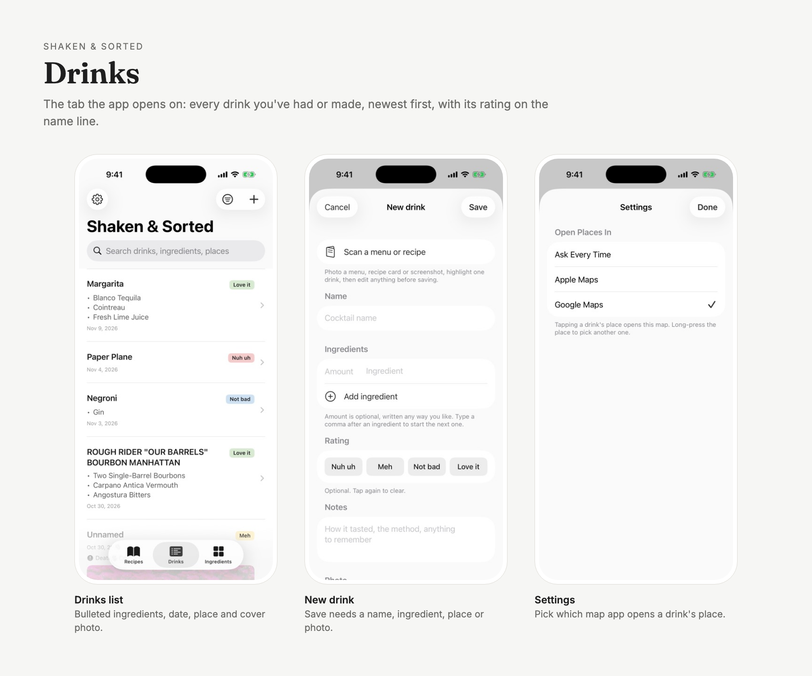
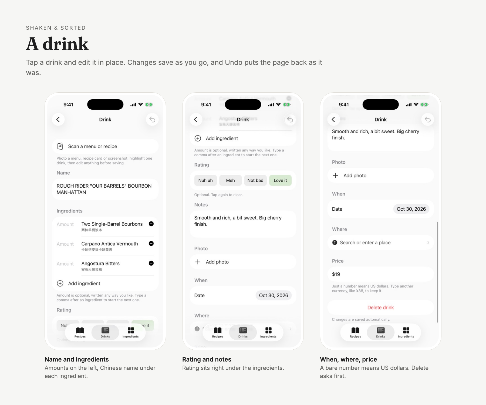
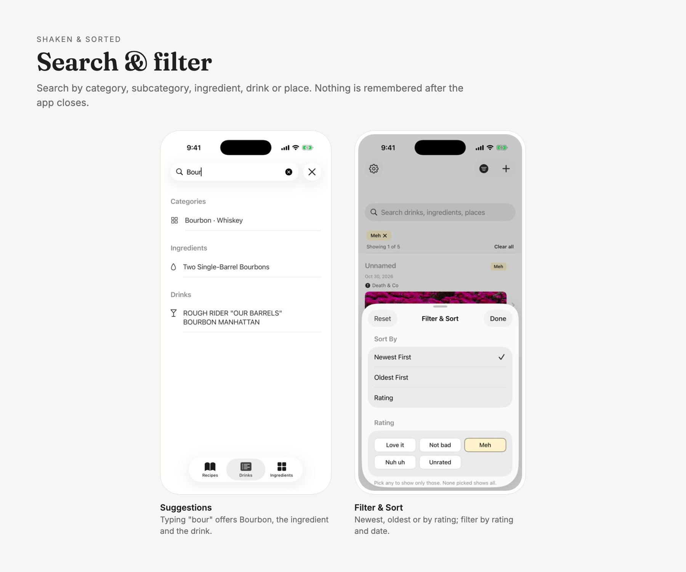
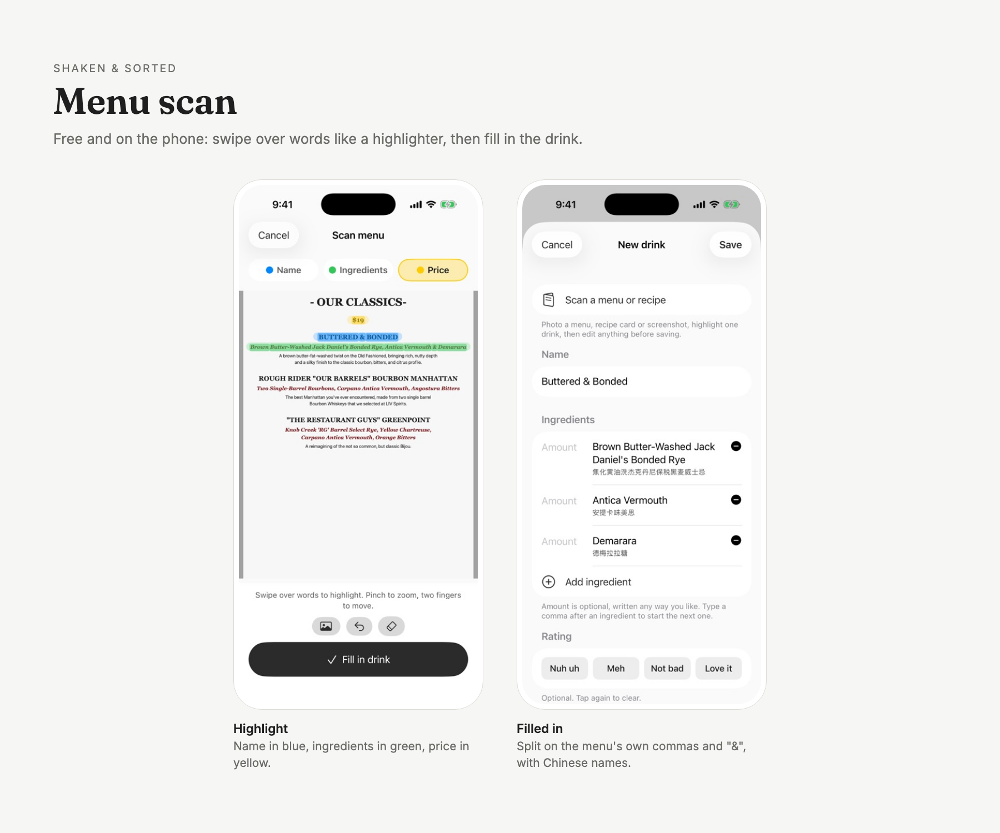
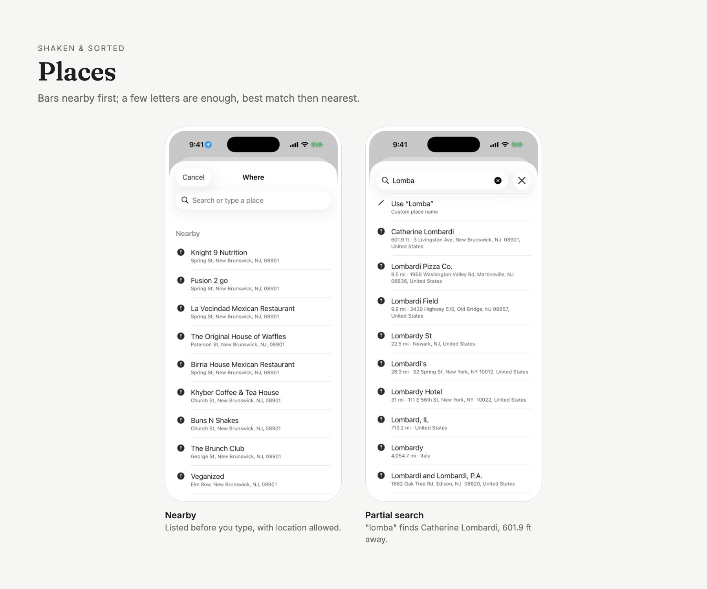
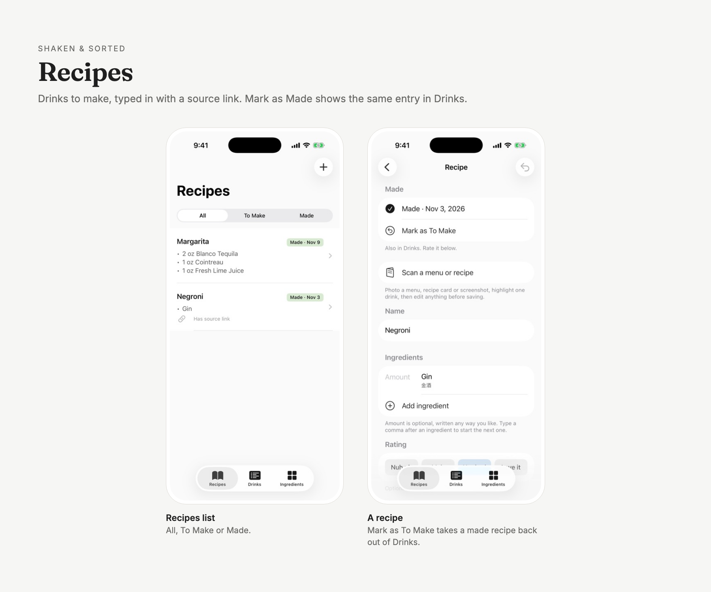
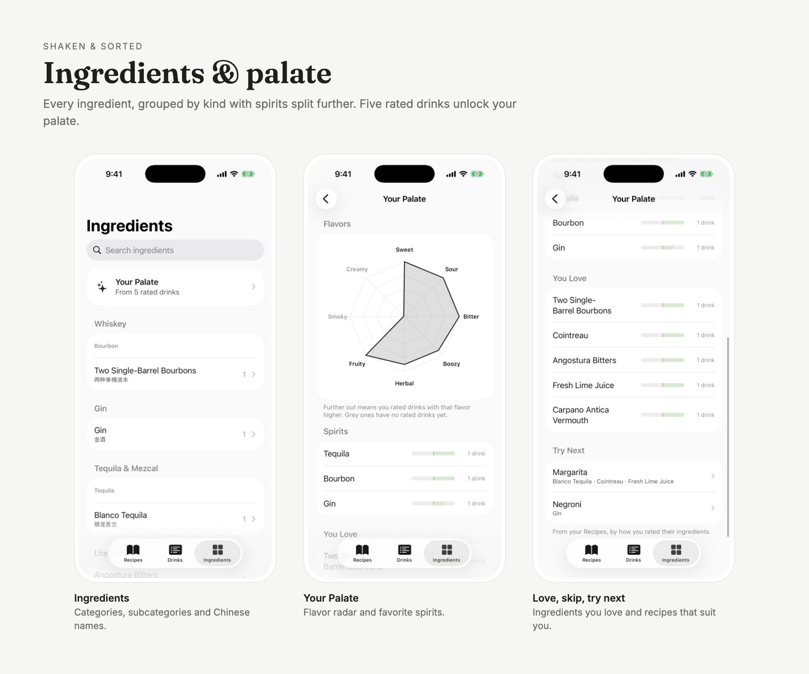

# Shaken & Sorted

iPhone app to log the cocktails you drink and make, save recipes you want to try, and see every ingredient you've had, sorted by kind.

Everything stays on your phone. No account, no server, no API key.

## Screens

All screens on one page: [docs/showcase/index.html](docs/showcase/index.html) (open it in a browser after downloading the repo).

## Features

**Drinks**
- Timeline of every drink you've had or made; tap one to edit it right there (changes save as you go, Undo puts it back as it was)
- Fields: name, ingredients with amounts, rating, notes, photos, date, place, price (a bare number means US dollars)
- Save needs **at least one** of name, ingredient, place, or photo; otherwise the app says so
- Amounts are written your way (`2 oz`, `¾ oz`, `2 dashes`), with unit buttons above the keyboard and an oz / ml view that never changes what you wrote
- Type a comma in an ingredient to start the next one
- Rating: Nuh uh, Meh, Not bad, Love it
- Several photos per drink: press and hold to drag them into order (the first is the cover), tap to view full screen and zoom
- Search drinks, ingredients, categories (Whiskey, or just Rye) and places, with suggestions as you type
- Filter & Sort: newest or oldest first, or by rating; filter by rating and date range

**Recipes tab** (left of Drinks, which the app opens on)
- Drinks you want to make, typed in by hand, with amounts, notes and a source link (Instagram, Xiaohongshu or any post)
- A recipe and a drink share the same page and sections; recipes have a source link, logged drinks a price
- **Mark as Made** puts the recipe in Drinks too, as the same entry, dated today and ready to rate; **Mark as To Make** takes it back out

**Scan from menu** (free, fully on device)
- Take or pick a photo of a menu, then swipe over words like a highlighter:
  **Name** (blue), **Ingredients** (green), **Price** (yellow)
- Pinch to zoom, two fingers to move, Undo / Clear to fix mistakes
- Ingredients are split on the menu's own punctuation (`,` `&` `and` `·` `/`), keeping names like `Brown Butter-Washed Rye` together
- ALL-CAPS menu text becomes Title Case; abbreviations such as XO or VSOP stay as printed
- The menu photo is added to the drink's photos

**Places**
- With location allowed, bars nearby are listed first, and a few letters (`lombar`) are enough to find a place, best match then nearest
- Open a drink's place in Apple Maps or Google Maps; pick a default in **Settings** (gear icon)

**Ingredients tab**
- Every ingredient you've logged, grouped into categories, with the main spirits split further
  (Bourbon, Rye, Scotch, Irish, Japanese; White, Aged, Dark Rum, Agricole; Tequila, Mezcal; Cognac, Armagnac, Pisco, Calvados)
- Sorted automatically from the name; tap an ingredient to fix its category, see its drinks, or show them in Drinks
- Each ingredient shows its Chinese name, from a built-in cocktail glossary (falling back to Apple's on-device translation); tap it on a drink to correct it
- **Your Palate** unlocks after 5 rated drinks: a flavor radar, favorite spirits, ingredients you love and ones to skip, and recipes to try next

## Install it on your own iPhone

There is no App Store or TestFlight build, so you build it yourself with Xcode. It's free — a normal Apple ID is enough.

**You need**
- A Mac with [Xcode](https://apps.apple.com/app/xcode/id497799835) (tested with Xcode 26)
- An iPhone on iOS 17 or later, and a cable

**Steps**
1. Download this repo: **Code → Download ZIP** on GitHub (or `git clone`), then unzip it.
2. Double-click `ShakenAndSorted.xcodeproj` to open it in Xcode.
3. Sign in with your Apple ID: **Xcode → Settings → Accounts → +**.
4. In the left sidebar click the blue **ShakenAndSorted** project, pick the **ShakenAndSorted** target, and open **Signing & Capabilities**:
   - **Team**: choose your own name (Personal Team).
   - **Bundle Identifier**: change it to something unique, e.g. `com.yourname.shakenandsorted`.
     The one in the repo belongs to the author's team and won't sign for you.
5. Plug in your iPhone, unlock it, and tap **Trust** if asked.
6. On the iPhone, turn on **Settings → Privacy & Security → Developer Mode** (it restarts the phone).
7. In Xcode's top bar, choose your iPhone as the run destination and press **Run** (▶).
8. The first time, the iPhone says "Untrusted Developer". Go to **Settings → General → VPN & Device Management**, tap your Apple ID, and choose **Trust**. Then open the app.

**With a free Apple ID** the app stops opening after 7 days. Plug the phone in and press **Run** again to renew it — your drinks are kept.

To try it without a phone, choose any iPhone simulator in step 7 instead.

## Notes

- Data is stored on device with SwiftData. Deleting the app deletes your drinks.
- Menu text recognition uses Apple's Vision framework on the phone; nothing is uploaded.
- The app asks for photo and camera access only when you add a photo or scan a menu, and for location only when you pick a place.
